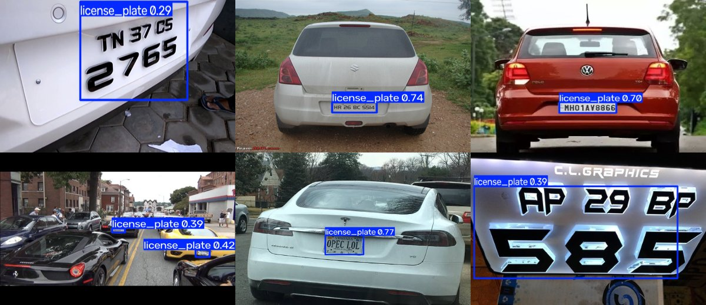

# License Plate Detection with YOLOv8

A detector that finds license plates in car images and videos.
I fine-tuned a COCO-pretrained YOLOv8n model on a public plate dataset and evaluated it on held-out images.



## Dataset

Kaggle "Car License Plate Detection" (433 images, 471 plates, CC0 license).
The boxes come in Pascal VOC XML format. The script converts them to YOLO format and splits the data 80/20 (347 train, 86 val images).
The dataset is not included in this repo.

## Steps

1. Convert the XML boxes to YOLO labels and split into train and val.
2. Fine-tune YOLOv8n for 30 epochs at image size 512.
3. Evaluate precision, recall and mAP on the validation set.
4. Run the model on new images or videos.

## Usage

```bash
pip install ultralytics
python plate_detector.py prepare --raw car_plate_raw   # folder with images/ and annotations/
python plate_detector.py train --epochs 30
python plate_detector.py evaluate
python plate_detector.py predict --source my_car.jpg
```

Use `--device 0` to train on a GPU. Results are saved in `runs/`.

## Results

Validation set, 86 images, 96 plates, confidence threshold 0.25.
Trained on CPU in about 1 hour.

| Metric    | Value |
|-----------|-------|
| Precision | 0.92  |
| Recall    | 0.90  |
| mAP50     | 0.89  |
| mAP50-95  | 0.49  |

The model finds most plates. Box placement is less exact (mAP50-95 is 0.49), and small plates far from the camera get low confidence scores.

## Tools

Python, Ultralytics YOLOv8, PyTorch, OpenCV
